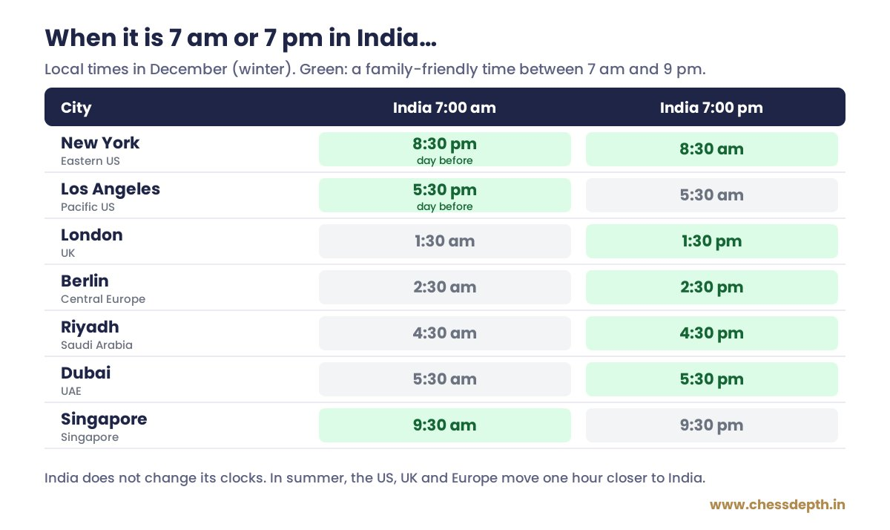

A child in Dubai, London or New Jersey can learn chess from a coach thousands of kilometres away. In an online class the coach and the student share the same board on screen, talk over video and solve positions together. Distance makes no difference.

What does make a difference is the practical side: finding a class time that works across time zones, choosing the right coach, setting up at home, and keeping up practice between lessons. This guide covers all four.

## 1. Make the time difference work for you

The first question most families abroad ask is: "What time would the class be for us?" If your coach is in India, the answer depends on where you live.

<figure class="cd-board" style="max-width:100%">
  <picture>
    <source srcset="/assets/images/blog/chess-classes-time-zones-india.webp" type="image/webp">
    
  </picture>
  <figcaption>The same class can fall at very different local times. Winter times shown.</figcaption>
</figure>

A few simple rules make it easy:

- **The Gulf, Europe and Singapore are close to India.** The UAE is 1½ hours behind India and Saudi Arabia 2½ hours behind, while Singapore is 2½ hours ahead. The UK is 4½ to 5½ hours behind, depending on the season. An Indian evening is your afternoon or early evening, which suits after-school classes.
- **North America is almost on the opposite side of the clock.** India is 9½ to 13½ hours ahead, so an Indian morning is your evening, and an Indian evening is your morning. Weekday evenings and weekend mornings are the usual choices.
- **Pick one regular slot and keep it.** A class at the same time every week becomes part of the routine, like a music lesson. Children who switch times often miss classes.
- **Watch the clocks change.** India does not use daylight saving time. The USA, Canada, the UK and Europe move their clocks in spring and autumn, so the gap with India changes by an hour twice a year. Confirm your class time with the coach in March and again in October or November.
- **Always agree the time in your own time zone.** "Saturday, 10 am New York time" is clearer than a time in India that you then have to convert.

## 2. One-to-one or a small group?

Both work well online. The choice depends on the child.

- **One-to-one** suits children who are already playing tournaments, who need a flexible timetable, or who learn best with the coach's full attention. Each lesson can be built around the student's own games.
- **A small group** of two to four students at the same level suits most young beginners. Children enjoy playing and discussing ideas with others, and it usually costs less. Look for small groups: in a class of ten or more, a shy child can go a whole lesson without saying a word.

Whichever you choose, ask how the coach decides the student's level and how they will know when the student is ready to move up.

## 3. How to choose a coach you have never met

When the coach is in another country, you can't drop in to watch a class. A few checks help:

1. **Check the rating.** Ask for the coach's FIDE ID and look it up on the official [FIDE ratings website](https://ratings.fide.com/). It shows their title, if they have one, and their rating.
2. **Take a demo class.** A good coach asks questions, lets the child think, and explains *why* a move works, not just which move to play.
3. **Ask about the plan.** Is there a syllabus, homework, and a regular test or quiz to measure progress? Structure matters even more online, where it is easy for lessons to drift into just playing games.
4. **Ask how they report progress.** Parents abroad should get clear, regular feedback, for example after every few weeks of classes.

## 4. Set up at home

Online chess needs very little equipment:

- A laptop, desktop or tablet. A phone screen is too small for a full lesson.
- A camera and a microphone, so the coach can see and hear the student.
- A stable internet connection and a quiet place to sit.
- A real chess board nearby. Setting up positions on a physical board helps children remember them.

Sit with a young child for the first few classes until they are comfortable with the platform, then let them work on their own.

## 5. Keep up practice between classes

One or two lessons a week is not enough by itself. The students who improve fastest do a little every day:

- **15 minutes of puzzles a day.** Short, regular practice beats a long session once a week. A [checking routine](/blog/cct-method-checks-captures-threats/) of checks, captures and threats is the best place to start.
- **Slow games.** Play a few games of 15 minutes or longer each week, not only blitz.
- **Write the moves down.** Recording a game and going through it afterwards with the coach is one of the best ways to learn. You can print our free [chess score sheet](/lab/resources/#score-sheet) for this.

## 6. Play over the board where you live

Online classes go well with real tournaments in your own country. Most countries have a national federation and local clubs with junior events: for example US Chess in the USA, the English Chess Federation in England, and national federations in the Gulf and Southeast Asia. A good coach can help your child prepare for these events and go through the games afterwards.

## 7. Paying a coach in another country

Agree the fee in one currency, usually per month, and pay through a service that shows the exchange rate and any fees before you pay. Pay monthly in advance and keep the receipts. Ask about the policy for missed classes and holidays before you start, as school holidays in your country will not match the coach's.

## Learning with ChessDepth from abroad

ChessDepth Academy teaches students in India and abroad, in one-to-one and small-group classes. We fix every class time in your own time zone and confirm it on WhatsApp. You'll find class times, fees in US dollars and how to pay on our pages for:

- [the USA and Canada](/online-chess-classes-usa/)
- [the UAE and the Middle East](/online-chess-classes-uae/)
- [the UK and Europe](/online-chess-classes-uk/)
- [Singapore and Southeast Asia](/online-chess-classes-singapore/)

The best way to see whether online classes suit your child is to try one. [Book a free demo class](/courses/), tell us your country and time zone, and we'll find a time that works.
