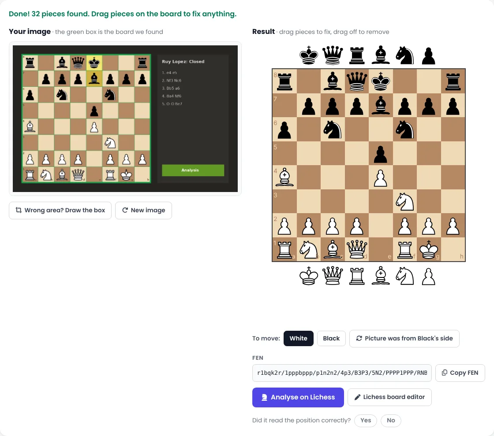

You find a great position in a YouTube video, a WhatsApp group or a chess book. You want to look at it properly with an engine. So you open a board editor and set up all 25 pieces by hand, one at a time, and hope you didn't put a knight on the wrong square.

Setting the position up often takes longer than studying it. Today we're launching a tool that fixes this.

**[ChessDepth AI](/ai/) is now live in beta, and it's free.** Give it a picture of a chess position and a few seconds later you have a real board.

<figure class="cd-board" style="max-width:100%">
  
  <figcaption>A screenshot goes in on the left. An editable board, the FEN and a Lichess link come out on the right.</figcaption>
</figure>

## How to use it

1. **Open [chessdepth.in/ai](/ai/)** on your phone or computer.
2. **Add your image.** Drag it onto the page, choose it from your files, or copy it and paste with Ctrl+V (Cmd+V on a Mac).
3. **Check the board.** The tool finds the chessboard in your picture and reads every square. If it isn't sure about a square, it highlights it in orange so you know where to look.
4. **Fix anything that's wrong.** Drag a piece to move it, drag it off the board to remove it, or add pieces from the rows above and below the board.
5. **Pick who is to move**, then **copy the FEN** or click **Analyse on Lichess** to open the position with an engine.

If the picture shows the board from Black's side, press **"Picture was from Black's side"** and the position turns the right way round. If the tool picks the wrong part of your image, press **"Wrong area? Draw the box"** and drag a square around the board yourself.

## How it works

Behind the button there are two steps.

**First, find the board.** A chessboard has a pattern no other part of a web page has: seven evenly spaced lines in each direction, where light squares flip to dark and back again. The tool searches the image for that pattern, then checks that the 64 squares really alternate light and dark.

**Second, read the squares.** Each of the 64 squares goes to a small neural network that we trained ourselves. It decides whether the square is empty or holds one of the 12 pieces (six white, six black). We taught it with hundreds of thousands of example squares drawn in 14 different piece styles, on many board colours, with arrows, highlights, coordinates and blurry, low-quality copies mixed in, so it doesn't depend on one website's look.

Finally a little chess sense is applied. There is exactly one king of each colour, pawns can't stand on the first or last rank, and the tool works out which side of the board White is on.

In our tests it reads about **99.7% of squares correctly** on clean 2D boards, in under a second.

## Your pictures stay with you

The whole thing runs **inside your browser**. Your image is never uploaded to us or anyone else, and the tool keeps working even on a slow connection once the page has loaded.

## What it's good at, and what it isn't (yet)

This is version 0.1, so it's fair to say where it stands:

- **Works best on:** screenshots from chess websites and apps, printed diagrams from books and worksheets, and boards in videos.
- **Not yet:** photos of a real wooden board on a table. That needs a different kind of model, and it's next on our list.
- **Unusual piece styles** can confuse it now and then. That's why it highlights the squares it's unsure about. Always take a two-second look before you analyse.

## Help us make it better

Under every result there's a simple question: *"Did it read the position correctly?"* Please tap **Yes** or **No**. Each answer tells us where the model needs more practice. If it gets a position badly wrong, send us the image on [WhatsApp](https://wa.me/919823029262) and we'll use it to train the next version.

## What's coming next

- **Photos of real boards**, so you can snap your over-the-board position after a game.
- **Book pages to puzzle sets:** turn a page of diagrams into puzzles you can solve on the board.
- **Tools for coaches** that turn printed worksheets into online homework.

## A thank you

ChessDepth AI stands on the shoulders of open-source chess. The piece styles we trained on come from [Lichess](https://lichess.org), shared under open licences, and the analysis button sends you to Lichess's free engine. We're grateful to the Lichess team and its contributors for making so much of chess free for everyone.

**[Try ChessDepth AI now →](/ai/)** Then tell us how it did.
