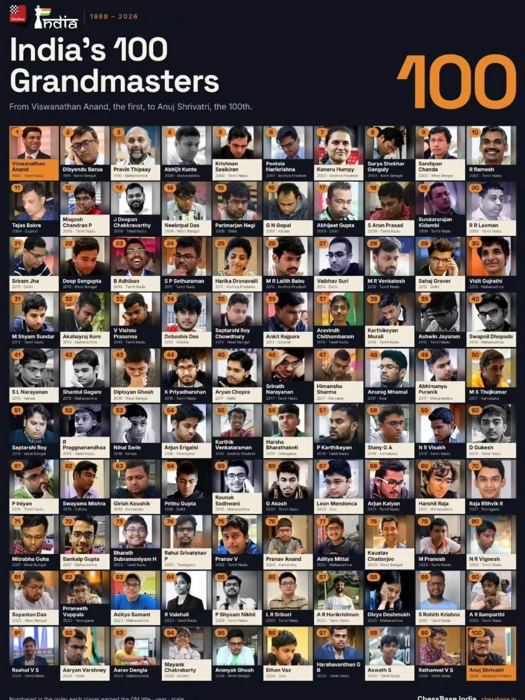

Indian chess has reached a landmark it took nearly four decades to build. On Sunday, Anuj Shrivatri won the 7th ASEAN Plus Individual Open Chess Championship in Ozamiz City, Philippines. The title made the 22-year-old International Master **India's 100th Grandmaster**, and the **first Grandmaster ever from Madhya Pradesh**.

He won it on Deepawali.

## A comeback in the Philippines

Shrivatri's tournament began badly: he lost his first game. Instead of fading, he scored **seven points from his remaining eight games**. He won his last two games to finish half a point ahead of Vietnam's Nguyen Duc Hoa, with the Philippines' Nouri Alekhine third on six points.

Winning this championship carries a **direct Grandmaster title**. Players usually earn the GM title the long way: three GM norms, each a performance above 2600 against a strong international field, plus a FIDE rating of at least 2500. Shrivatri had one GM norm and a rating in the high 2400s. His win in the Philippines took him straight to the title.

## Years in the making

The result is new, but the player isn't. Shrivatri, who is from Bhopal, became an International Master in 2019. At the time he was the youngest IM from Madhya Pradesh. Since then he has been a regular threat in strong open tournaments:

- He beat two Grandmasters in a row at the 2023 Dubai Open.
- He finished third at the 2022 Gujarat GM Open.
- In 2025 he was runner-up at the Bengaluru GM Open and at the Vaujany Open, and won a First Saturday GM round-robin.
- In 2026 he won several rapid events.

He also coaches students online, so he knows the game from both sides of the board.

## "A cracker of a 100"

Viswanathan Anand completed his Grandmaster norms in December 1987 and became India's first GM in 1988. He was among the first to react:

> "Happy Diwali. A cracker of a 100... Congrats to Anuj on getting India to this milestone."

Anand added that he had been thinking that very day about the 40th anniversary of his own GM title, which falls in December 2027.

All India Chess Federation president Nitin Narang called it a historic moment, writing "GRANDMASTER No. 100 FOR BHARAT!" and "Onwards to 200 Grandmasters!"

## From 1 to 100

The journey from one Grandmaster to a hundred says a lot about how far Indian chess has come:

- **1988:** Anand becomes India's first GM.
- **1997:** Pravin Thipsay becomes the third, nearly a decade later.
- **End of 2011:** India has 25 Grandmasters.
- **2022:** At the Chennai Olympiad, Anand hopes India will reach 75 GMs in its 75th year of independence. Four years later the count has climbed past that.
- **July–November 2026:** India's 96th to 100th GMs, Ethan Vaz, Harshavardhan G B, Aswath S, Rathanvel V S and now Anuj Shrivatri, earn their titles in about four months.

ChessBase India has put all hundred of them in one picture: every Indian Grandmaster, numbered in the order they earned the title, with the year and their state.

<figure class="cd-board" style="max-width:100%">
  
  <figcaption>India's 100 Grandmasters, from Viswanathan Anand to Anuj Shrivatri. Graphic: <a href="https://chessbase.in" target="_blank" rel="noopener">ChessBase India</a>.</figcaption>
</figure>

The next big moment comes later this month, when world champion Gukesh Dommaraju defends his title against Javokhir Sindarov in Geneva.

## What it means for young players in Madhya Pradesh

For us at ChessDepth, this story is close to home. Our academy is also based in Bhopal, and many of our students have played in the same local and state events where Anuj built his game.

Every student can take three lessons from his title:

1. **A bad start is not the end.** He lost in round one and still won the championship.
2. **Titles come from years of steady work.** IM, a first norm, strong opens, then the breakthrough.
3. **You don't have to leave Madhya Pradesh to reach the top.** The state finally has its first Grandmaster. It surely won't be the last.

Congratulations, GM Anuj Shrivatri, from the whole ChessDepth family.

*Sources: [ESPN](https://www.espn.com/chess/story/_/id/50420444/india-100-chess-grand-master-gm-anuj-shrivatri), [PTI via Deccan Chronicle](https://www.deccanchronicle.com/nation/mps-anuj-shrivatri-becomes-indias-100th-grandmaster-2002802), [ANI](https://www.aninews.in/news/sports/others/anuj-shrivatri-becomes-indias-100th-grandmaster-madhya-pradeshs-first20261108214205/), [ETV Bharat](https://www.etvbharat.com/en/sports/anuj-shrivatri-becomes-100th-grandmaster-for-india-winning-asean-plus-individual-open-chess-championship-enn26110900410), [ChessBase India](https://chessbase.in).*
