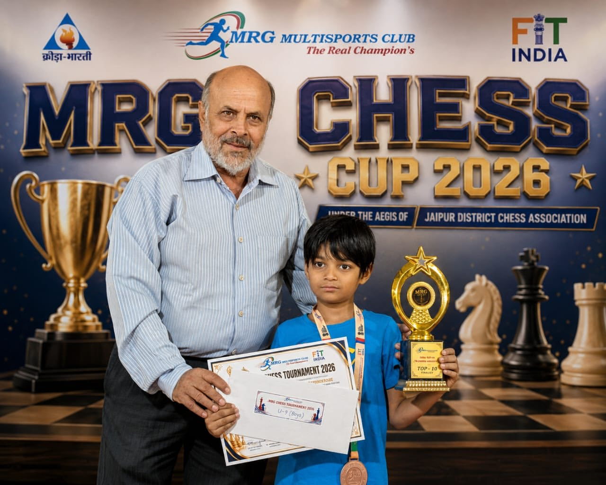

One of our youngest students has just joined the international rating list. **Adamya Veer Joshi**, from Kota, Rajasthan, is six years old, and FIDE, the world chess federation, has now published his first official rating: **1586 in rapid chess**. That makes him **one of the youngest players in Rajasthan ever to get a FIDE rating**.

<figure class="cd-board" style="max-width:100%">
  <picture>
    <source srcset="/assets/images/blog/adamya-veer-joshi-mrg-chess-cup-2026.webp" type="image/webp">
    
  </picture>
  <figcaption>Adamya with his Top-10 trophy in the Under-9 boys' section of the MRG Chess Cup 2026, Jaipur.</figcaption>
</figure>

<strong>Highlights</strong>
<ul style="margin:.5rem 0 0">
<li>One of the youngest players in Rajasthan to get a FIDE rating, at the age of six</li>
<li>First FIDE rapid rating: 1586, almost 200 points above the starting floor of 1400</li>
<li>Earned at the 1st Kota International Open, 3–4 October 2026, in his home city</li>
<li>Top-10 finalist in the Under-9 boys' section of the MRG Chess Cup 2026, Jaipur</li>
</ul>

## A first rating, earned at home in Kota

Adamya earned the rating at the **1st Kota International Open FIDE Rapid Rating Chess Tournament 2026**, played in his home city on 3 and 4 October 2026, with more than 200 players in the field. The result went onto FIDE's November rating list.

To get a FIDE rating, a new player has to score points against opponents who already have one. Adamya played five games against rated players in Kota. Their average rating was 1570, and most of them were far older than he is. He scored **2 points out of 5** against them, and that was enough: his name now stands on the FIDE list with a rapid rating of 1586.

For comparison, a first FIDE rating starts at 1400. Adamya, born in 2020, begins his rated career almost 200 points above that line.

| | |
|---|---|
| **Player** | Joshi, Adamya Veer (India) |
| **Born** | 2020 (aged 6) |
| **FIDE ID** | [591001790](https://ratings.fide.com/profile/591001790) |
| **FIDE rapid rating** | 1586 |
| **Rating event** | 1st Kota International Open FIDE Rapid, Kota, 3–4 October 2026 |
| **Result against rated players** | 2 points from 5 games (average opponent 1570) |

## One of the youngest in Rajasthan

Very few children anywhere get an international rating at six. Most players earn their first one years later, because it means holding your own against rated opponents in a FIDE-rated event, with a clock, a full room and no help from anyone.

In Rajasthan, the youngest player reported to have got a FIDE rating was six years and two months old, in 2024. Adamya, born in 2020, has done it at the age of six too, which puts him among the youngest in the state's chess history.

## Top 10 in the Under-9s in Jaipur

The rating is not his only result this year. At the **MRG Chess Cup 2026** in Jaipur, held under the aegis of the Jaipur District Chess Association, Adamya played in the **Under-9 boys'** section, against children up to three years older, and came home with a **Top-10 finalist** trophy, a medal and a certificate.

## What we see in his training

Adamya trains with ChessDepth coach Sourabh Joshi. What stands out in class is not a bag of opening tricks. It is that he enjoys the game, sits through a full game without rushing, and is happy to look at a lost game again to find the move he missed.

Those are the habits we try to build in every young student:

1. **Look before you move.** Checks, captures and threats, for both sides, on every move.
2. **Play real games.** Tournaments teach what puzzles cannot: clocks, nerves, and shaking hands after a loss.
3. **Keep it fun.** At six, a rating is a milestone to enjoy, not a target to chase. The love of the game comes first, and results follow from it.

## For parents

Parents often ask us when a child is "ready" for tournaments. There is no single age. A child who knows the rules well, can finish a game without help and can lose without it ruining the day is ready to try a local event. If you would like to know how we teach children of this age, see our [chess classes for kids](/chess-classes-for-kids/) and our [parent's guide to chess for kids](/blog/chess-for-kids-a-parents-guide/).

Congratulations, Adamya, from everyone at ChessDepth. We are proud of you, and we are looking forward to your next game.

*Sources: [Udaipur Kiran, August 2024](https://udaipurkiran.com/udaipurs-swayam-becomes-rajasthans-youngest-fide-rated-chess-player/) for the earlier Rajasthan record; [FIDE rating report, 1st Kota International Open FIDE Rapid 2026](https://ratings.fide.com/report.phtml?event=494569) and Adamya's [FIDE profile](https://ratings.fide.com/profile/591001790).*
