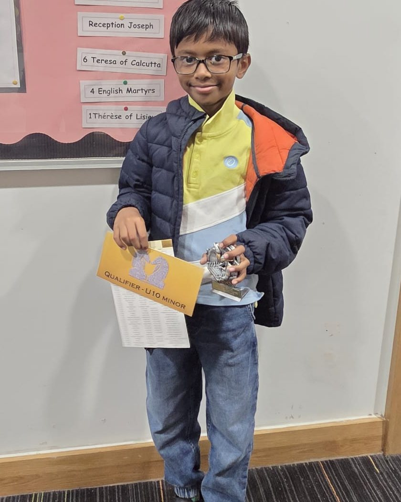
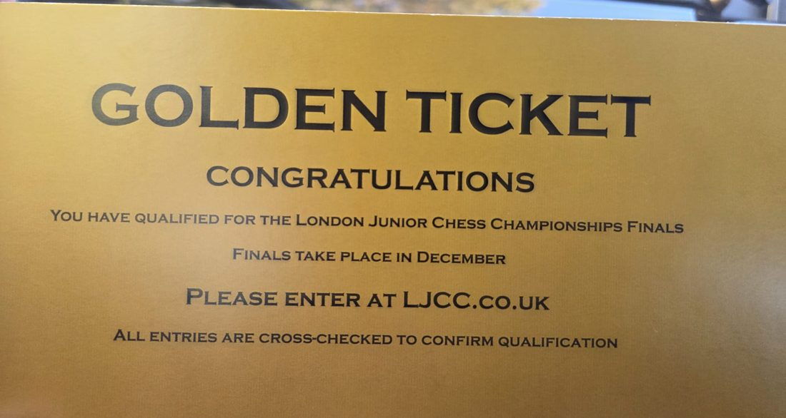

Good news from London. Our student **Revaan Ranjan**, aged eight, has qualified for the Finals of the **London Junior Chess Championships (LJCC)**, one of the best-known junior tournaments in Britain. He came home from Saturday's qualifier with a trophy and a Golden Ticket.

<figure class="cd-board" style="max-width:420px">
  <picture>
    <source srcset="/assets/images/blog/revaan-ranjan-ljcc-qualifier-2026.webp" type="image/webp">
    
  </picture>
  <figcaption>Revaan with his trophy and his "Qualifier – U10 Minor" card.</figcaption>
</figure>

<strong>Highlights</strong>
<ul style="margin:.5rem 0 0">
<li>Qualified for the LJCC Under-10 Minor Finals, to be played in December</li>
<li>Scored 3.5 points from 6 games in an ECF-rated event</li>
<li>Started as the 34th seed in a field of 48 players</li>
<li>Aged 8, in a section for players up to 9</li>
</ul>

## The qualifier

The event was the **Desert Penguins Ealing LJCC Qualifier**, played on Saturday 14 November 2026 at The Holy Family Catholic Primary School in west London. The Under-10 section had 48 players and six rounds in one day, and the games count for English Chess Federation (ECF) ratings.

Revaan started as the 34th seed out of 48, so most of the players in the room were rated above him. Over six rounds he scored **3.5 points**, which is the score needed for a place in the Under-10 Minor Final.

| | |
|---|---|
| **Player** | Revaan Ranjan (England), aged 8 |
| **Event** | Desert Penguins Ealing LJCC Qualifier, Under-10 |
| **Date and place** | 14 November 2026, London W3 |
| **Field** | 48 players, 6 rounds, ECF rated |
| **Starting rank** | 34th |
| **Score** | 3.5 points from 6 games |
| **Result** | Qualified for the LJCC Under-10 Minor Finals |

## What is the LJCC?

The London Junior Chess Championships have been played since 1924, which makes them more than a hundred years old. Many of England's strongest players took part as children.

Players in the Under-8, Under-10 and Under-12 age groups cannot simply enter the Finals. They have to earn a place at one of the qualifying tournaments held around the country each autumn. In the Under-10 section, a score of 3.5 or 4 points out of 6 earns a place in the Minor Final, and 4.5 or more earns a place in the Major Final.

Those who make it receive a Golden Ticket.

<figure class="cd-board" style="max-width:560px">
  <picture>
    <source srcset="/assets/images/blog/ljcc-golden-ticket-2026.webp" type="image/webp">
    
  </picture>
  <figcaption>Revaan's Golden Ticket to the Finals in December.</figcaption>
</figure>

## How Revaan trains

Revaan lives in London and takes his ChessDepth classes online with coach Sourabh Joshi. A one-day event with six games is a long day for an eight-year-old. To score in the later rounds you have to stay calm after a loss and keep concentrating when you are tired, and that is what he did.

What we work on with players of his age is simple:

1. **Check before you move.** Checks, captures and threats, for both sides.
2. **Use your time.** In a rapid game the clock is part of the game, but a few seconds of thought on each move saves pieces.
3. **Learn from every game.** After a tournament we go through the games together, the wins as well as the losses.

## What comes next

The Finals take place in London in December. Between now and then, Revaan will keep working on his tactics and his endgames, and on playing longer games.

Congratulations, Revaan, from everyone at ChessDepth. Enjoy the Finals!

If your child would like to start playing tournaments, see our [chess classes for kids](/chess-classes-for-kids/) and our [parent's guide to chess for kids](/blog/chess-for-kids-a-parents-guide/).

*Sources: [tournament page on Chess-Results](https://s1.chess-results.com/tnr1512629.aspx?lan=1&art=0&SNode=S0) and the [London Junior Chess Championships](https://www.ljcc.co.uk/).*
