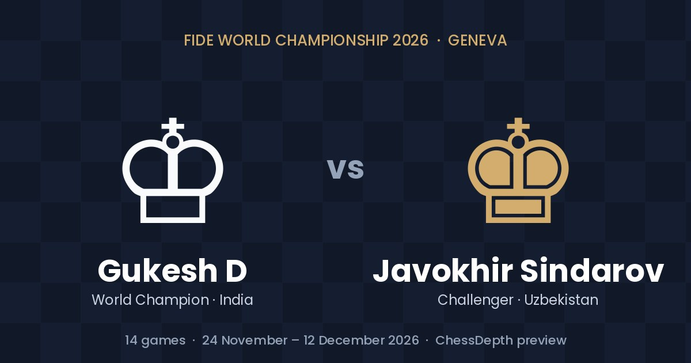
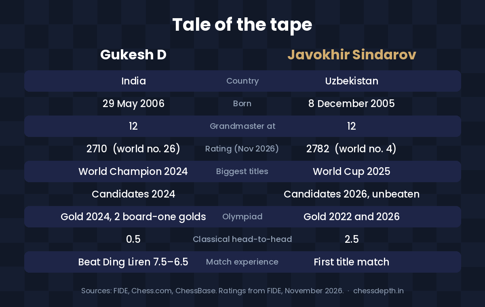

<figure class="cd-board" style="max-width:640px">
  <picture>
    <source srcset="/assets/images/blog/og-wcc-2026-gukesh-sindarov.webp" type="image/webp">
    
  </picture>
</figure>

Tomorrow, 24 November, the first move is played in the biggest match in chess. **Gukesh D**, the World Champion from India, defends his title for the first time against **Javokhir Sindarov** of Uzbekistan. Both are 20 years old, which makes this the **youngest World Championship match in history**.

On paper this is a mismatch: the challenger is higher rated, in better form and leads their personal score. But World Championship matches have a habit of ignoring the paper. Here is everything you need to know before game 1.

## The match at a glance

| | |
|---|---|
| **Players** | Gukesh D (India, champion) vs Javokhir Sindarov (Uzbekistan, challenger) |
| **Venue** | Fondation Martin Bodmer, Cologny, near Geneva, Switzerland |
| **Dates** | Opening ceremony 22 Nov · Game 1 on **24 Nov** · last classical game 11 Dec · tiebreaks (if needed) 12 Dec |
| **Format** | Up to 14 classical games; the first player to 7.5 points wins |
| **Time control** | 120 minutes for 40 moves, then 30 minutes, with 30 seconds added per move from move 41 |
| **Draw offers** | Not allowed before move 40 |
| **If it's 7–7** | Rapid games (15+10), then shorter rapid and blitz games until someone wins |
| **Prize fund** | US$2.5 million |

The prize fund has a twist: each player earns **US$200,000 for every game he wins**, and the rest is split equally. So every decisive game is worth real money, on top of the title. Switzerland last hosted a World Championship match in 2004.

## How Gukesh got here

Gukesh's rise is one of the great stories in chess.

- **Grandmaster at 12.** He was one of the youngest players ever to earn the title.
- **Olympiad gold.** He won individual gold on board one at the 2022 and 2024 Olympiads, and team gold with India in Budapest in 2024.
- **Candidates 2024.** At 17 he became the youngest player ever to win the Candidates Tournament.
- **World Champion at 18.** In Singapore in December 2024 he beat Ding Liren 7.5–6.5, winning the final game, to become the **youngest undisputed World Champion in history**. He also later beat Magnus Carlsen in classical chess at Norway Chess 2025.

The last year has been hard. In 2026 he finished:
- 10th at Tata Steel in January;
- 9th at the Prague Masters;
- last at Norway Chess;
- last at the Chennai Grand Masters.

His rating fell from 2794 in October 2024 to the low 2700s. He pulled out of the classical Grand Chess Tour events to focus on training, and he has spoken openly, in a conversation with Viswanathan Anand, about how hard the pressure of the title has been.

But there were signs of a turnaround. At the **Samarkand Olympiad in September** he played on board four, scored 8.5 out of his first 10 games unbeaten, won the decisive game against Germany from a difficult position, and took the **silver medal on his board**.

## How Sindarov got here

Sindarov's last twelve months may be the strongest run by any young player since Carlsen.

- **Grandmaster at 12** as well, and an Olympiad gold medallist with Uzbekistan in Chennai in 2022.
- **World Cup 2025, Goa.** He beat China's Wei Yi in the final tiebreaks to become the **youngest World Cup winner ever**, at 19.
- **Candidates 2026, Cyprus.** He won with a round to spare, **unbeaten**, with six wins and 10/14. That's the most wins by anyone since the Candidates became a double round-robin in 2013. He is the first Uzbek player to reach a classical World Championship match.
- **Olympiad 2026.** Team gold on home soil in Samarkand, plus a bronze medal on board two.
- **Rating 2782**, his career best and world number 4.

He is known for sharp, aggressive chess and very accurate calculation, and the strongest players describe him as an all-round player without obvious weak spots.

<figure class="cd-board" style="max-width:720px">
  
</figure>

## Head-to-head

In classical chess, **Sindarov leads 2.5–0.5**. He won their games in 2018 and 2022, and their most recent meeting, at Tata Steel in January 2026, was drawn, though Sindarov had to escape from a lost position. In rapid and blitz Sindarov leads 2–1. When they met at the Grand Chess Tour in Warsaw in May, Gukesh won one game with a fist pump and Sindarov struck back later in the event.

## What the chess world is saying

Most experts lean towards the challenger, but not all of them.

**Backing Sindarov**
- **Magnus Carlsen**, world number one, calls Sindarov a <q>pretty significant favorite</q>. He believes Sindarov is more well-rounded and warns that the match could turn ugly if Gukesh falls behind early. He also says Gukesh has everything to gain, and that if Gukesh leads early he immediately becomes the favourite himself.
- **Fabiano Caruana** gives Sindarov a slight edge, about 55–45.
- **Garry Kasparov** has also named Sindarov as the favourite.
- **Ian Nepomniachtchi**, who has played two title matches, puts it at 65–35 for Sindarov, and **Vladislav Artemiev** at 60–40.
- **Nodirbek Abdusattorov**, Sindarov's Uzbek teammate, has predicted that Gukesh will lose the title.
- **Betting markets** make Sindarov a clear favourite, at roughly 63 to 73%.

**Calling it even**
- **R Praggnanandhaa** says it's 50–50 and refuses to pick a favourite.
- **Anish Giri, Maxime Vachier-Lagrave, Vincent Keymer** and **Hans Niemann** also call it a coin toss.
- **Viswanathan Anand** said in the summer that Pragg was playing better than Gukesh at that moment, but that anything can change.
- **Krishnan Sasikiran** points out that match experience is on Gukesh's side: he has already won a World Championship match, and Sindarov hasn't played one.

**Backing Gukesh**
- **Hikaru Nakamura** is Gukesh's strongest supporter, and is sure his rating will bounce back.
- **Denis Lazavik** has also picked Gukesh.

**And the players themselves?** Sindarov puts his own chances at 50.1% against 49.9%. He says he is preparing for the best version of Gukesh, and reminds everyone that people expected Ding Liren to lose easily in 2024, yet that match was very close.

## My view

> **Gukesh has real chances, but Sindarov is the favourite. Anything can happen in a World Championship match, and we're really looking forward to it.**

I agree with the majority, with one big caution. Ratings and recent results favour Sindarov. But a 14-game match is a different sport from a tournament. Gukesh beat a higher-rated Ding Liren in 2024 by staying calm, fighting in every game and pouncing on one mistake at the very end. If he wins an early game, the pressure flips onto the challenger.

## What to watch for

1. **The first three games.** Carlsen's point is the key one: whoever strikes first changes the psychology of the whole match.
2. **Opening preparation.** Both teams have had months to prepare. Watch for surprise openings in the first White games.
3. **The clock.** Gukesh often thinks deeply early and can get into time trouble. With a 30-second increment only after move 40, the first time control matters.
4. **Endgames.** In long matches, the player who converts small advantages usually wins. Sindarov's technique has been excellent this year; Gukesh's grit in long games is his weapon.
5. **Nerves.** Sindarov has never played a title match. Gukesh has, and won. That counts for something.

## For our students

A World Championship match is the best free chess lesson of the year. Here's how to follow it:

- **Watch live** on the official FIDE broadcast, Lichess or Chess.com.
- **Guess the move** before it's played, then check whether the players agree with you.
- **Replay each game** the next day in our free [Lichess game analyser](/lab/resources/), and look at the critical moment where the evaluation changed.
- **Learn the openings** they play: many of them, such as the Italian, the Ruy Lopez and the Queen's Gambit, are in our free [opening courses](/lab/openings/).

We'll be following every game at ChessDepth. Who's your pick: Gukesh or Sindarov?

*Sources: [FIDE: schedule, format and prize fund](https://www.fide.com/salesforce-fide-world-championship-match-2026-schedule-format-and-prize-fund-confirmed/), [FIDE: match preview](https://www.fide.com/?p=51815), [Chess.com: Carlsen on the match](https://www.chess.com/news/view/carlsen-calls-sindarov-significant-favorite-against-gukesh-rules-out-comeback), [Chess.com: Carlsen and Caruana predictions](https://www.chess.com/news/view/carlsen-caruana-gukesh-sindarov-predictions), [Chess.com: Gukesh on pressure](https://www.chess.com/news/view/gukesh-pressure-sindarov-world-championship), [Chess.com: Sindarov wins the World Cup](https://www.chess.com/news/view/2025-fide-world-cup-final-tiebreaks), [ChessBase: Sindarov wins the Candidates](https://en.chessbase.com/post/candidates-tournament-2026-o-13), [ChessBase: Olympiad 2026](https://en.chessbase.com/post/chess-olympiad-2026-11), [ESPN: Gukesh's 2026](https://www.espn.com/chess/story/_/id/49417280/gukesh-dommaraju-nightmare-2026-threatens-derail-world-championship-defence), [Zamin.uz: expert predictions](https://zamin.uz/en/sport/223202-battle-for-the-world-crown-why-the-chess-elite-considers-sindarov-the-favorite-against-gukesh.html), [Cyprus Mail: Sindarov interview](https://cyprus-mail.com/2026/09/02/sindarov-focuses-on-preparation-over-predictions-ahead-of-gukesh-title-clash), [Sports Digest: Praggnanandhaa](https://sportsdigest.in/praggnanandhaa-on-gukesh-vs-sindarov-clash/192835/), [Sports Digest: Anand](https://sportsdigest.in/viswanathan-anand-advises-gukesh/195412/), [The Pioneer: Sasikiran](https://dailypioneer.com/news/gukesh-must-improve-speed-technique-sasikiran), [Chessdom: betting markets](https://www.chessdom.com/javokhir-sindarov-is-a-clear-favorite-ahead-of-historic-world-chess-championship-2026-clash-with-gukesh/).*
