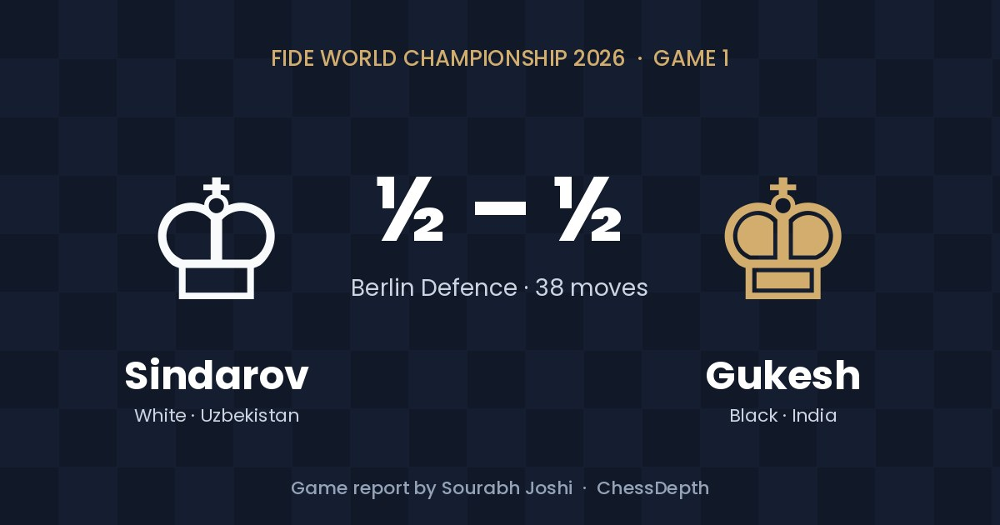
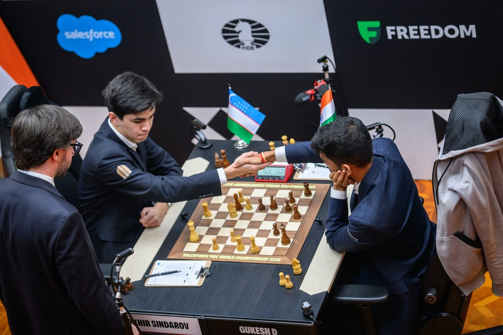
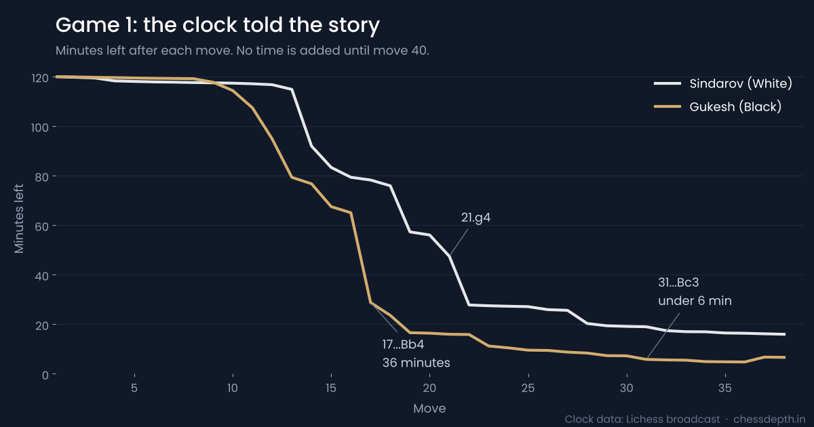

<figure class="cd-board" style="max-width:640px">
  <picture>
    <source srcset="/assets/images/blog/og-wcc26-game-1.webp" type="image/webp">
    
  </picture>
</figure>

The 2026 World Championship has begun with a draw, and it was not a quiet one. **Javokhir Sindarov**, with White, got exactly what a challenger hopes for in game 1: a small edge on the board and a big lead on the clock. **Gukesh D** spent a lot of time, dropped to under six minutes for eight moves, and still found every move he needed. After 38 moves the players repeated the position and the score is **½–½**.

For me this was a **hard-fought and well-deserved draw**. Neither player made a real mistake, and both had to play precise chess to keep the balance.

<figure class="cd-board" style="max-width:820px">
  <picture>
    <source srcset="/assets/images/blog/wcc26-g1-handshake.webp" type="image/webp">
    
  </picture>
  <figcaption>The handshake: Sindarov and Gukesh after the draw in Game 1, Geneva. Photo: a friend of ChessDepth in Geneva.</figcaption>
</figure>

## Game 1 at a glance

| | |
|---|---|
| **White** | Javokhir Sindarov (Uzbekistan, 2782) |
| **Black** | Gukesh D (India, World Champion, 2710) |
| **Date and venue** | Tuesday 24 November 2026, Fondation Martin Bodmer, Cologny, near Geneva |
| **Opening** | Ruy Lopez, Berlin Defence, Berlin Endgame (C67) |
| **Result** | Draw by repetition after 38 moves |
| **Match score** | Gukesh ½ – ½ Sindarov |
| **Clocks at the end** | Sindarov about 16 minutes, Gukesh about 6½ minutes |

Before the game, FIDE President **Timur Turlov** made the ceremonial first move 1.e4 for Sindarov, and **Viswanathan Anand** replied 1...e5 for Gukesh.

## The full game

**Sindarov – Gukesh, World Championship 2026, Game 1**

1.e4 e5 2.Nf3 Nc6 3.Bb5 Nf6 4.O-O Nxe4 5.d4 Nd6 6.Bxc6 dxc6 7.dxe5 Nf5 8.Qxd8+ Kxd8 9.Rd1+ Ke8 10.Nc3 Ne7 11.h3 Ng6 12.Be3 Be7 13.Ne4 Bd7 14.c4 a5 15.Rd2 a4 16.Rad1 Be6 17.b3 Bb4 18.Re2 h6 19.Ng3 c5 20.Nh5 Rg8 21.g4 Ke7 22.Ne1 axb3 23.axb3 Nxe5 24.f4 g6 25.Ng3 Nc6 26.f5 gxf5 27.Nxf5+ Kf6 28.Rf2 Rgd8 29.Nd3 Bxf5 30.Rxf5+ Kg7 31.Rh5 Bc3 32.Bxh6+ Kg8 33.Rg5+ Kh7 34.Rh5 Kg8 35.Rg5+ Kh7 36.Rh5 Kg8 37.Rg5+ Kh7 38.Rh5 Kg8 **½–½**

- [Download the annotated game (PGN)](/downloads/wcc-2026-game-1-sindarov-gukesh.pgn) and open it in Lichess, ChessBase or any chess app.
- [Replay it move by move on Lichess](https://lichess.org/broadcast/fide-world-chess-championship-2026/game-1/xLgOJ6cb/j7pdr7s2).

## The opening: Gukesh goes Berlin

Gukesh chose the **Berlin Defence**, the same wall Vladimir Kramnik built against Garry Kasparov in their 2000 match. Sindarov accepted the challenge with 4.O-O and allowed the famous **Berlin Endgame**: the queens come off on move 8, Black's king stays in the centre and loses the right to castle, and White has a healthy pawn majority on the kingside.

According to *The Times of India*, Gukesh had played this opening with Black in only eight games before (seven draws and one win), and Sindarov had never played it in serious competition. So both players were stepping into fresh territory.

Sindarov had clearly prepared deeply. He played his first 13 moves at speed, ending with **13.Ne4**, and Gukesh's reply **13...Bd7** already took the game into a new position. From here the World Champion had to think for himself, and he did, at great cost on the clock.

## Critical moment 1: the 36-minute decision





This was the moment the match got its first real tension. A World Champion spending more than half an hour on one move in game 1 tells you how well Sindarov had prepared.

## Critical moment 2: Sindarov's best chance



{% include answer.html text="**21.Ne1!** was stronger. The knight heads for d3 or c2, White keeps the e5-pawn protected and the bishop on b4 has to be dealt with. Stockfish gives White a small but lasting edge, around **+0.4**, for example **21...Nxe5 22.f4 Nc6 23.Nd3**. After **21.g4** the advantage was almost gone (about +0.1). Sindarov played 22.Ne1 one move later, but by then Black's 21...Ke7 had already improved the king. This was White's best moment in the whole game, and it is not easy to see: in the Berlin Endgame, small knight manoeuvres often matter more than pawn pushes." %}

It was also the most expensive move of the game for White in time terms: Sindarov spent about 20 minutes on his next move, 22.Ne1. From here, Gukesh had **16 minutes for 19 moves**.

## Critical moment 3: the only king move

Gukesh then won a pawn with **23...Nxe5**, and Sindarov answered with a sharp kingside attack: **24.f4 g6 25.Ng3 Nc6 26.f5! gxf5 27.Nxf5+**. With about nine minutes on his clock, Gukesh had to find the right square for his king.





## Critical moment 4: the perpetual



{% include answer.html text="**32.Bxh6+!** White wins back the pawn and starts checking. **32...Kg8 33.Rg5+ Kh7 34.Rh5 Kg8 35.Rg5+** and the rook swings between g5 and h5. Black cannot escape: if the king steps away, it walks into more checks, and blocking with **33...Bg7?** fails to **34.Bxg7 Rd6 35.Be5+** with a winning position for White. Without 32.Bxh6+, White has nothing better, and Black's bishop on c3 and active rooks would start to cause trouble. So both sides had good reasons to accept the repetition." %}

## The clock battle

The board was level for most of the game, but the clock was not.

<figure class="cd-board" style="max-width:820px">
  
</figure>

- After **13...Bd7**, Gukesh was already about 25 minutes behind.
- **17...Bb4** cost him 36 minutes, leaving 28 minutes against 78.
- By **31...Bc3**, he had **under six minutes** for nine moves, with no extra time until move 40.

Even so, his moves in the time scramble were the engine's top choice almost every time. After the game, Gukesh said he felt he was **"always under control"** and that the position looked equal throughout. Looking at the engine evaluation, I agree with him: Black was never worse than about +0.5.

## The draw claim and the two-minute penalty

There was one strange moment at the end. In this match the players **cannot agree a draw before move 40**; a draw before then is only possible by threefold repetition or stalemate, claimed through the arbiter. Sindarov **claimed a draw that was not yet valid**. The arbiters ruled the claim incorrect, and as a penalty **Gukesh was given two extra minutes** (you can see his clock jump from 4:40 to 6:38 on move 37). It made no difference: the repetition came a move later and the players shook hands.

For students, this is a useful lesson. A draw by repetition must be **claimed correctly**: the same position, with the same player to move, must appear three times. An incorrect claim can cost you time on the clock.

## My view

This was a **hard-fought and well-deserved draw**. Sindarov showed that his team has prepared seriously, and he got the better of the opening on the clock. But Gukesh showed the quality that won him the title in 2024: he did not panic, he found the only move with 27...Kf6, and he defended with less than six minutes for the last part of the game.

Before the match I wrote that **Sindarov is the favourite, but Gukesh has real chances, and anything can happen**. Game 1 supports all three parts. Sindarov's preparation looks dangerous, Gukesh's defence looks strong, and the match is wide open.

The worry for Gukesh is time. He cannot afford to fall 50 minutes behind in every game with Black. The good news is that in **game 2**, today, **Wednesday 25 November**, Gukesh has the **white pieces**. The game starts at **7:30 PM IST** (15:00 in Geneva).

## Lessons for our students

1. **Know your structure, not just your moves.** In the Berlin Endgame, Black's plan is to keep the king safe in the centre and use the bishop pair. Gukesh's 17...Bb4 and 21...Ke7 follow those ideas, even in a new position.
2. **Check the "only move" when your king is attacked.** At move 27 the obvious capture lost material, and the king move saved the game. When you are in check, look at every king move before you capture.
3. **A perpetual check is a weapon.** Sindarov used 32.Bxh6+ to make sure the game ended safely when Black was becoming active.
4. **Manage your clock.** Gukesh got away with it, but spending 36 minutes on one move leaves very little time for the rest of the game.

*Sources: moves and clock times from the [official Lichess broadcast](https://lichess.org/broadcast/fide-world-chess-championship-2026/game-1/xLgOJ6cb/j7pdr7s2). Reports: [FIDE](https://www.fide.com/salesforce-fide-world-championship-match-a-draw-in-the-opening-game/), [ChessBase](https://en.chessbase.com/post/world-championship-2026-1), [ChessBase India](https://chessbase.in/news/world-championship-2026-game-1-report), [ChessBase India news bite](https://chessbase.in/news-bites/game-1-gukesh-holds-sindarov), [Chess.com](https://www.chess.com/news/view/2026-fide-world-chess-championship-game-1), [Deccan Chronicle](https://www.deccanchronicle.com/sports/world-chess-championship-2026-gukesh-draws-first-game-against-sindarov-2007702) and The Times of India (print edition, 25 November 2026). The critical moments were checked with Stockfish. For the background of the match, read our [World Championship 2026 preview](/blog/world-chess-championship-2026-gukesh-vs-sindarov-preview/).*
