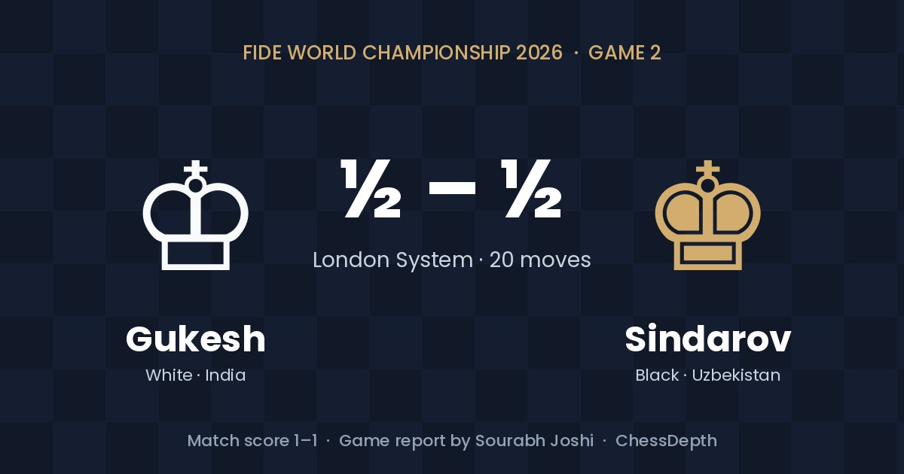
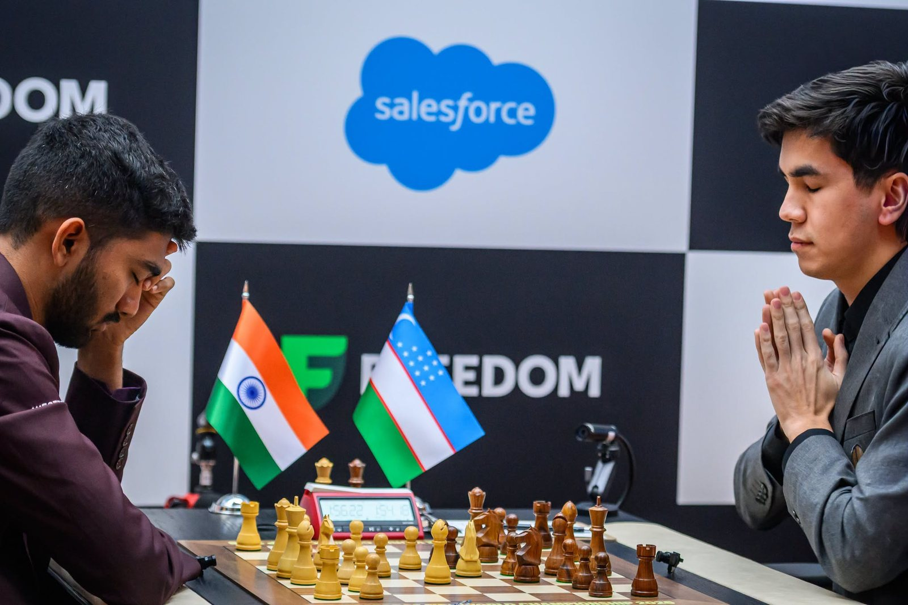
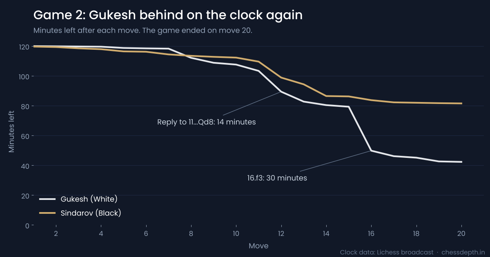
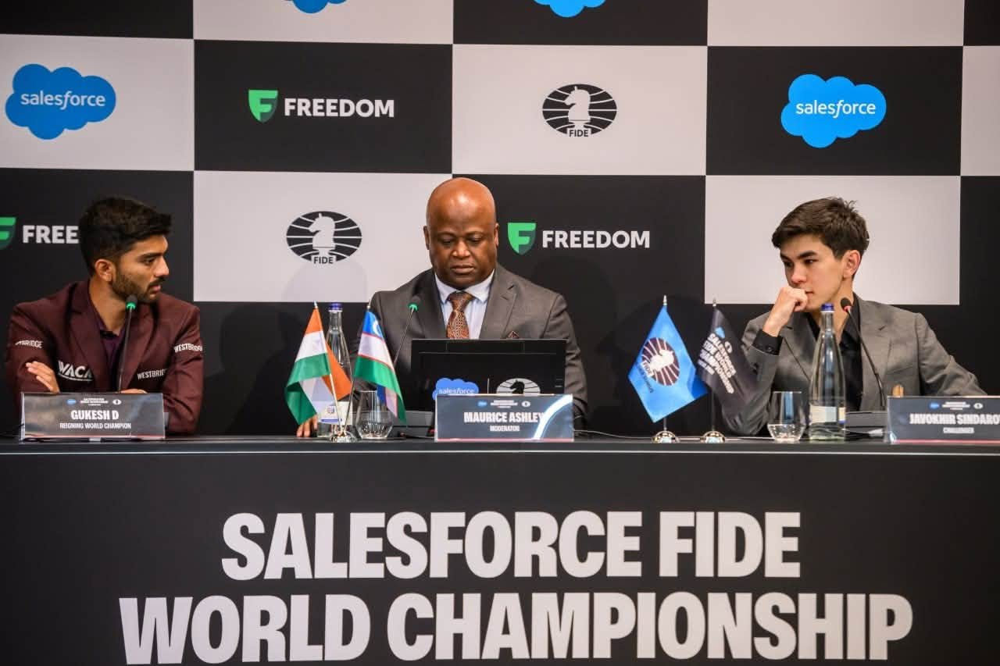

<figure class="cd-board" style="max-width:640px">
  <picture>
    <source srcset="/assets/images/blog/og-wcc26-game-2.webp" type="image/webp">
    
  </picture>
</figure>

After the fight of Game 1, Game 2 was the opposite. **Gukesh D**, with White for the first time in the match, chose the **London System**. **Javokhir Sindarov** was ready for it, and after 20 moves the bishop and knight were shuffling between the same squares. The game was drawn by threefold repetition, and the match score is **1–1**.

Let me be honest: this was a quick and quiet game, close to a snoozefest for the fans. But even a short game at this level has decisions worth studying, and the clock tells an interesting story again.

<figure class="cd-board" style="max-width:820px">
  <picture>
    <source srcset="/assets/images/blog/wcc26-g2-board.webp" type="image/webp">
    
  </picture>
  <figcaption>Gukesh and Sindarov during Game 2 in Geneva. Photo: Michal Walusza, Yoav Nis / FIDE.</figcaption>
</figure>

## Game 2 at a glance

| | |
|---|---|
| **White** | Gukesh D (India, World Champion, 2710) |
| **Black** | Javokhir Sindarov (Uzbekistan, 2782) |
| **Date and venue** | Wednesday 25 November 2026, Fondation Martin Bodmer, Cologny, near Geneva |
| **Opening** | Queen's Pawn Game, London System (D02) |
| **Result** | Draw by threefold repetition after 20 moves |
| **Match score** | Gukesh 1 – 1 Sindarov |
| **Clocks at the end** | Gukesh about 42 minutes, Sindarov about 81 minutes |

## The full game

**Gukesh – Sindarov, World Championship 2026, Game 2**

1.d4 d5 2.Nf3 Nf6 3.Bf4 c5 4.e3 e6 5.Nbd2 Nc6 6.c3 Be7 7.Ne5 Qb6 8.Rb1 Nxe5 9.Bxe5 Bd7 10.a4 O-O 11.Bd3 Qd8 12.O-O Rc8 13.Ra1 Be8 14.Qe2 Nd7 15.Bg3 f5 16.f3 Nf6 17.Be5 Nd7 18.Bg3 Nf6 19.Be5 Nd7 20.Bg3 Nf6 **½–½**

- [Download the annotated game (PGN)](/downloads/wcc-2026-game-2-gukesh-sindarov.pgn) and open it in Lichess, ChessBase or any chess app.
- [Replay it move by move on Lichess](https://lichess.org/broadcast/fide-world-chess-championship-2026/game-2/L3j03TZq/p6HX9bPF).

## The opening: Gukesh goes London

The London System is the opening many club players love: White plays d4, Nf3 and Bf4, then builds a solid pyramid with e3 and c3. It is famous for being safe, and less famous at World Championship level. Ding Liren brought it to the big stage, playing it against Ian Nepomniachtchi in 2023 and twice against Gukesh in 2024. This time it was Gukesh's turn. According to *The Times of India*, he called it a nostalgic choice, an opening he played a lot during the lockdown days.

Sindarov answered with the most direct test, **7...Qb6**, hitting the b2-pawn. That was the first move that made Gukesh think: he spent six minutes on **8.Rb1**. Then came Sindarov's surprise, **11...Qd8**, putting the queen straight back on its home square. It looks strange, but the queen had done its job by provoking Rb1, and from d8 it supports the c5 and d5 pawns. Gukesh needed 14 minutes for his reply.

## Critical moment 1: which way to recapture?





## Critical moment 2: the 30-minute think





## Critical moment 3: repeat or play on?



{% include answer.html text="**17.Be5** puts the bishop back on its strong central square, hitting the knight on f6. After **17...Nd7 18.Bg3 Nf6** the same position keeps coming back. White could keep the game going with **17.a5!**, gaining queenside space, when Stockfish gives a tiny edge, about **+0.25**, for example **17...Bd6 18.Bxd6 Qxd6 19.Rfc1**. But that edge is very small, and Gukesh was almost 40 minutes behind on the clock. He decided not to take any risk. Sindarov later described the position as super-safe for both players." %}

According to Lichess, this was the shortest World Championship draw since Game 9 of Carlsen–Anand in 2014.

## The clock battle

<figure class="cd-board" style="max-width:820px">
  
</figure>

For the second game in a row, Sindarov played faster in the opening. Gukesh used 14 minutes after 11...Qd8 and 30 minutes on 16.f3, and ended the game with about half of Sindarov's time. When the press asked Sindarov about the long thinks, he answered with a smile: "When my opponent thinks, I'm just trying to chill!"

<figure class="cd-board" style="max-width:820px">
  <picture>
    <source srcset="/assets/images/blog/wcc26-g2-press.webp" type="image/webp">
    
  </picture>
  <figcaption>Gukesh and Sindarov at the press conference with moderator Maurice Ashley. Photo: Michal Walusza, Yoav Nis / FIDE.</figcaption>
</figure>

## My view

This was not a game for the highlights. But I don't think it was a bad day for Gukesh. After a tough Game 1 with Black, he made sure the match stays level, and he got a "free" safe game to recover energy.

The worry is the same as after Game 1: **Sindarov's preparation is excellent, and Gukesh is the one spending the time.** In a 14-game match you cannot only draw with White. At some point Gukesh will have to choose a sharper opening and make Sindarov think for himself. If he does not, the pressure will build up in his Black games.

So I stay with my prediction: Sindarov is the slight favourite, Gukesh has real chances, and anything can happen.

**Game 3 is today, Thursday 26 November, at 7:30 PM IST**, with **Sindarov playing White**. Friday is the first rest day.

## Lessons for our students

1. **The London is not only a "safe" opening.** Black's ...Qb6 and ...c5 test it directly, so you must know how to answer them, not just play the same moves every game.
2. **Recapture with a plan.** 9.Bxe5 and 9.dxe5 lead to very different games. Before you take back, ask which structure you want.
3. **Watch your opponent's next move.** Gukesh's 16.f3 prepared e4, and Sindarov's 16...Nf6 stopped it immediately. Always check what your opponent can do against your plan.
4. **A draw by repetition is a decision.** Gukesh chose it because the edge was tiny and he was behind on the clock. In your games, think about the clock and the match situation, not only the position.

*Sources: the moves and clock times are from the [official Lichess broadcast](https://lichess.org/broadcast/fide-world-chess-championship-2026/game-2/L3j03TZq/p6HX9bPF). Reports: [Chess.com](https://www.chess.com/news/view/2026-fide-world-chess-championship-game-2), [ChessBase](https://en.chessbase.com/post/world-championship-2026-analysis-daniel-king2), [Lichess](https://lichess.org/@/Lichess/blog/wcc-2026-round-2-a-speedy-london-draw/tIcbLj1J), [The Week in Chess](https://theweekinchess.com/twic-news-feed/gukeshs-london-system-doesnt-surprise-sindarov), [ESPN](https://www.espn.com/chess/story/_/id/50591889/gukesh-sindarov-live-world-chess-championship-2026-game-2-updates) and The Times of India (print edition, 26 November 2026). The key moments were checked with Stockfish. Read the [Game 1 report](/blog/world-chess-championship-2026-game-1-sindarov-gukesh/) and our [match preview](/blog/world-chess-championship-2026-gukesh-vs-sindarov-preview/).*
