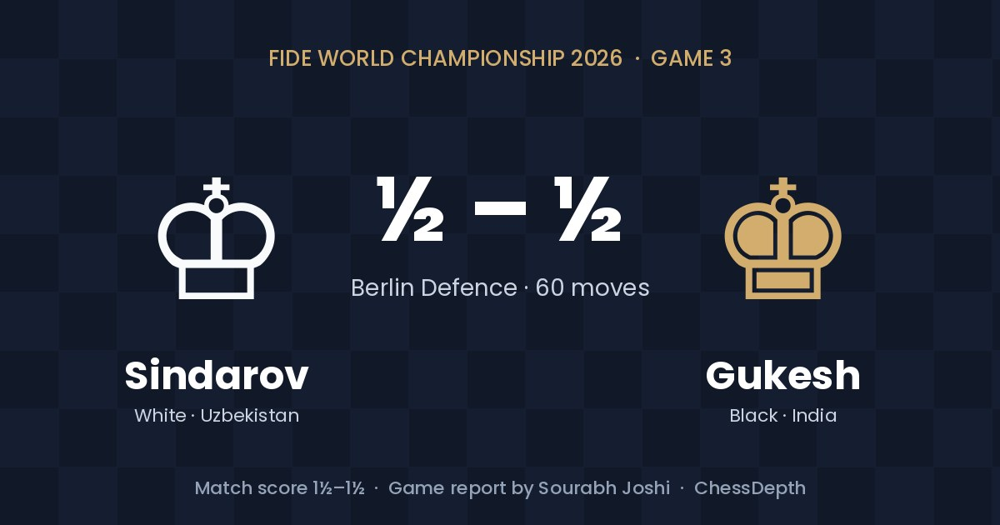
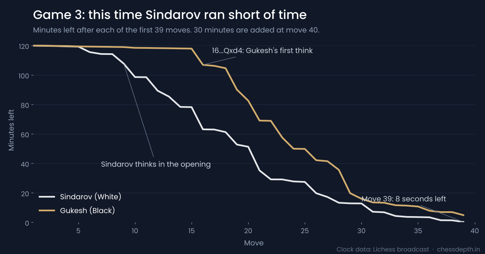

<figure class="cd-board" style="max-width:640px">
  <picture>
    <source srcset="/assets/images/blog/og-wcc26-game-3.webp" type="image/webp">
    
  </picture>
</figure>

This was the game the match needed. After a quiet Game 2, **Gukesh D** came to Game 3 with a real surprise in the opening, played his first 15 moves in under three minutes, and turned the clock battle around. **Javokhir Sindarov** had to work hard for every move and reached move 40 with only seconds left. He kept his nerve, and after nearly five hours and 60 moves the game ended in a draw.

The match is level at **1½–1½**, and Friday is the first rest day.

## Game 3 at a glance

| | |
|---|---|
| **White** | Javokhir Sindarov (Uzbekistan, 2782) |
| **Black** | Gukesh D (India, World Champion, 2710) |
| **Date and venue** | Thursday 26 November 2026, Fondation Martin Bodmer, Cologny, near Geneva |
| **Opening** | Ruy Lopez, Berlin Defence, Rio de Janeiro Variation (C67) |
| **Result** | Draw after 60 moves, nearly five hours of play |
| **Match score** | Gukesh 1½ – 1½ Sindarov |
| **Clocks on move 39** | Sindarov 8 seconds, Gukesh about 5 minutes |

## The full game

**Sindarov – Gukesh, World Championship 2026, Game 3**

1.e4 e5 2.Nf3 Nc6 3.Bb5 Nf6 4.O-O Nxe4 5.d4 Be7 6.Qe2 Nd6 7.Bxc6 bxc6 8.dxe5 Nf5 9.Qe4 g6 10.Nd4 Nxd4 11.Qxd4 d5 12.Nc3 Be6 13.Na4 Qb8 14.a3 Qb5 15.Be3 Qc4 16.b3 Qxd4 17.Bxd4 Bf5 18.Ra2 a5 19.f3 h5 20.Re1 g5 21.c3 Kd7 22.Nc5+ Bxc5 23.Bxc5 Rhb8 24.b4 axb4 25.cxb4 Ra4 26.Raa1 Ke6 27.Bd4 Bd3 28.Re3 Bc4 29.f4 gxf4 30.Rf3 Rba8 31.h3 Kf5 32.g3 Ke6 33.Kg2 c5 34.Bxc5 d4 35.Rxf4 Bd5+ 36.Kf2 d3 37.b5 Rxf4+ 38.gxf4 Bc4 39.Bb4 Bxb5 40.Rc1 c6 41.Ke3 Rg8 42.Ke4 f5+ 43.exf6 Rg2 44.Bc3 Re2+ 45.Kf3 c5 46.Re1 Bc6+ 47.Kg3 Rxe1 48.f5+ Kxf5 49.Bxe1 Kxf6 50.Kf4 Ke6 51.Ke3 Bb5 52.a4 Ba6 53.Kd2 Ke5 54.Bf2 Kf4 55.h4 Kg4 56.Kc3 Kf3 57.Be1 Ke2 58.Bd2 Kf3 59.Bg5 Ke2 60.Bd2 Kf3 **½–½**

- [Download the annotated game (PGN)](/downloads/wcc-2026-game-3-sindarov-gukesh.pgn) and open it in Lichess, ChessBase or any chess app.
- [Replay it move by move on Lichess](https://lichess.org/broadcast/fide-world-chess-championship-2026/game-3/fnmEB1kH/RD8sbYw1).

## The opening: a surprise from 1908

In Game 1, Gukesh defended with the Berlin Endgame. This time he went back to the Berlin, but with **5...Be7**, the **Rio de Janeiro Variation**. It is an old line: *The Times of India* points out that Emanuel Lasker and Siegbert Tarrasch played it three times in their 1908 World Championship match. Gukesh then chose **8...Nf5** instead of the usual 8...Nb7, a rare move that, according to several reports, had not been seen at this level for almost 40 years.

The surprise worked on the clock. Gukesh played his first 15 moves in under three minutes, while Sindarov used more than half an hour on his first 12 moves. By move 16, Gukesh was about 50 minutes ahead.

## Critical moment 1: grab a pawn or trade queens?





## Critical moment 2: a pawn sacrifice for activity





## Critical moment 3: 76 seconds to find a defence





After move 40, both players got 30 extra minutes, and the rest of the game was technical. Black won back the material and ended up a pawn ahead, but with **bishops of opposite colours** the position was a fortress, and the players drew on move 60.

## The clock battle

<figure class="cd-board" style="max-width:820px">
  
</figure>

For the first time in the match, it was Sindarov who was short of time. In Games 1 and 2 Gukesh was the one falling behind. This time his preparation gave him a huge lead early, and the pressure he built in the middlegame meant Sindarov reached move 40 with just seconds left.

## My view

This was Gukesh's best game of the match so far. The opening choice was smart and brave: an old, almost forgotten line that took Sindarov out of his preparation and onto his own clock. And with Black, against the favourite, Gukesh was the one asking the questions in the second half of the game.

But I want to give Sindarov a lot of credit too. Playing 39.Bb4 with 8 seconds on the clock, in a World Championship, tells you a lot about his nerves. He is only 20, and he did not crack.

After three games, the picture is clear: both players are very well prepared, and neither will give anything away easily. I still see Sindarov as the slight favourite, but Gukesh has shown that he can make him uncomfortable. Anything can happen.

**Friday 27 November is a rest day. Game 4 is on Saturday 28 November at 7:30 PM IST, with Gukesh playing White.**

## Lessons for our students

1. **Old openings can be new weapons.** Gukesh used a line from 1908. If your opponent has not seen a position before, they have to spend their own time on it.
2. **Don't grab every pawn.** 16...Qxc2 won a pawn but gave White an active rook. 16...Qxd4 kept everything safe.
3. **Active pieces are worth a pawn.** 33...c5 gave up a pawn to make the bishop and d-pawn strong.
4. **Know your fortresses.** With bishops of opposite colours, an extra pawn is often not enough to win. Knowing this helps you defend, and helps you avoid wasting time trying to win a drawn position.

*Sources: the moves and clock times are from the [official Lichess broadcast](https://lichess.org/broadcast/fide-world-chess-championship-2026/game-3/fnmEB1kH/RD8sbYw1). Reports: [Chess.com](https://www.chess.com/news/view/2026-fide-world-chess-championship-game-3), [The Tribune](https://www.tribuneindia.com/news/sports/world-chess-championship-gukesh-finds-his-mojo-pushes-sindarov-into-time-trouble-as-game-3-turns-into-a-fight), [Oneindia](https://www.oneindia.com/sports/world-chess-championship-third-game-drawn-as-gukeshs-preparation-proves-superior-8271383.html), [World Today Journal](https://world-today-journal.com/gukesh-and-sindarov-draw-third-world-chess-championship-match-with-rare-opening/) and The Times of India (print edition, 27 November 2026). The critical moments were checked with Stockfish. Read the [Game 1](/blog/world-chess-championship-2026-game-1-sindarov-gukesh/) and [Game 2](/blog/world-chess-championship-2026-game-2-gukesh-sindarov/) reports and our [match preview](/blog/world-chess-championship-2026-gukesh-vs-sindarov-preview/).*
